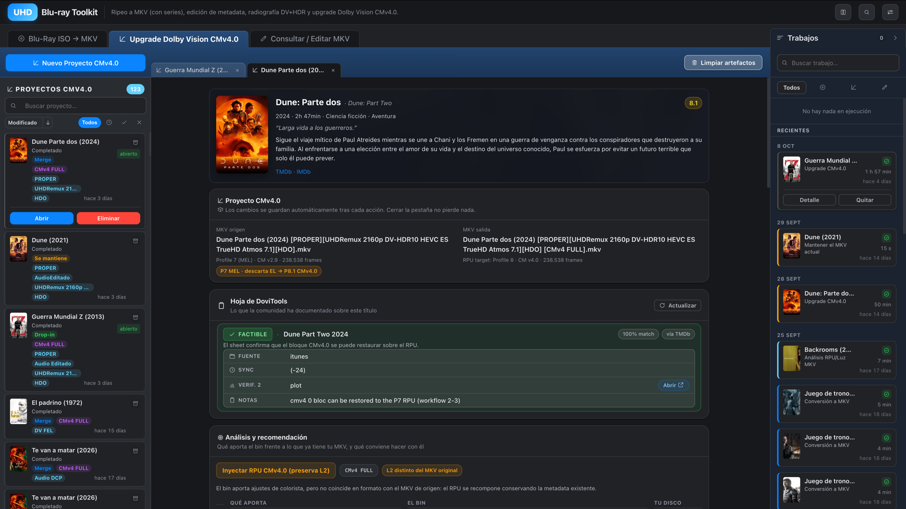
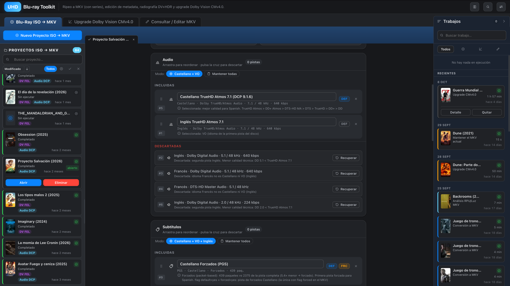
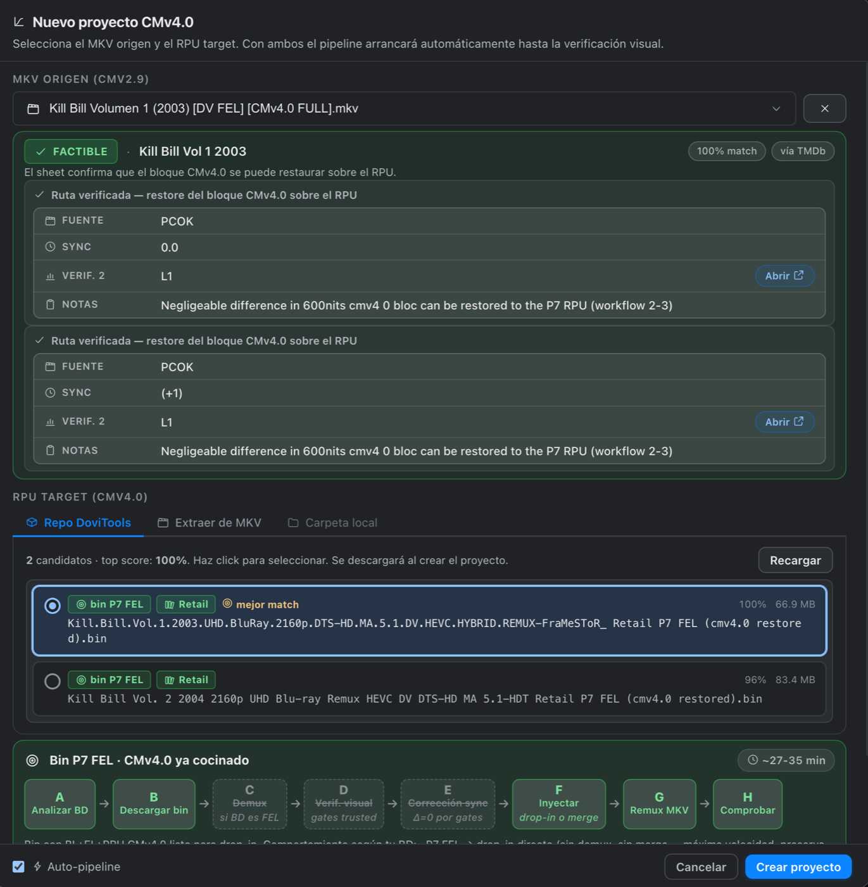
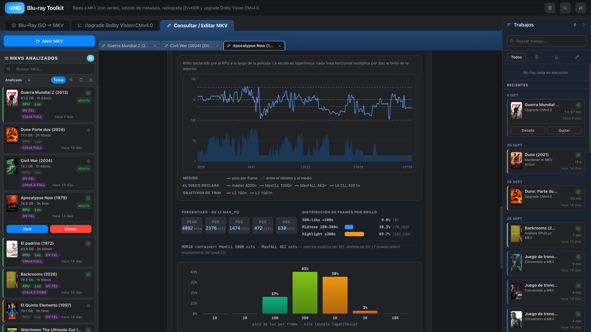
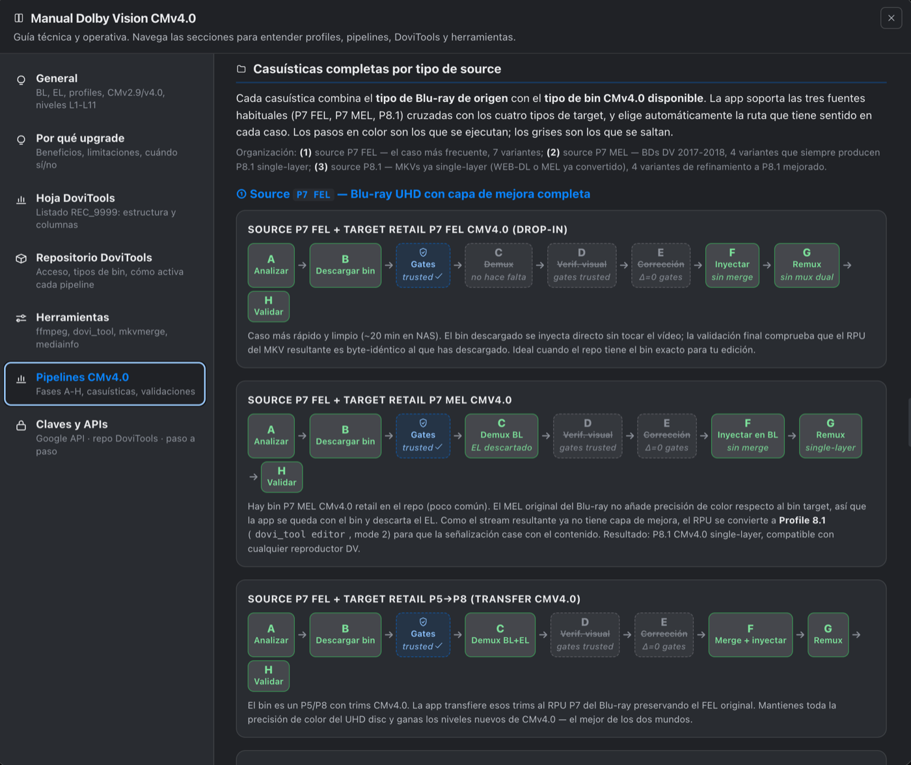
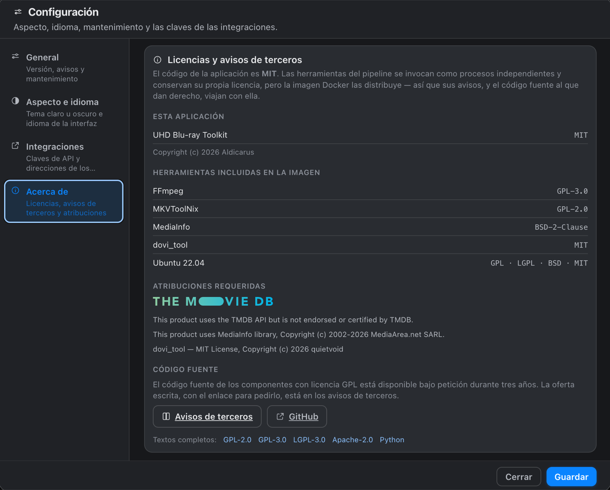

<div align="center">

# UHD Blu-ray Toolkit

**The best version of every film, in a single MKV.**

The full picture of the UHD Blu-ray, with its Dolby Vision FEL layer intact,<br>
upgraded with the colorist's CMv4.0 grade, and verified down to the last frame.

[](https://github.com/Aldicarus/hdo-iso-converter/releases/latest)
[](https://github.com/Aldicarus/hdo-iso-converter/pkgs/container/hdo-iso-converter)
[](LICENSE)

[Why](#why) · [Installation](#installation) · [Features](#features) · [Technical documentation](docs/TECHNICAL.md) · [Acknowledgements](#acknowledgements)



</div>

---

## Why

No single source has the best version of a film.

- **The UHD Blu-ray has the best picture.** It has the highest bitrate available, and on many discs Dolby Vision **Profile 7 FEL**: a full enhancement layer that carries picture information the base layer and streaming releases do not have.
- **Streaming has the newest grading metadata.** Many streaming masters carry Dolby Vision **CM v4.0**, with trims the colorist made by hand for different kinds of displays. The disc only carries the older CM v2.9.

UHD Blu-ray Toolkit puts the two together. It turns the disc into an MKV that keeps every layer, adds the colorist's CMv4.0 to it, and then shows exactly what ended up inside the file, so the result can be checked rather than assumed. Picture and sound are never re-encoded: they are the disc's, bit for bit.

It runs on a NAS or any Linux machine with Docker and is used from the browser. Long jobs keep going after the browser is closed.

| | |
|---|---|
| 💿 **Blu-ray ISO → MKV** | A lossless MKV of the disc, with the Dolby Vision FEL layer, the best audio tracks and the chapters |
| ✨ **Dolby Vision CMv4.0 upgrade** | Adds the colorist's CMv4.0 trims to the disc's own Dolby Vision, without touching the picture |
| 🔬 **Inspect / Edit MKV** | The DV+HDR deep dive of any MKV, to check the result, plus instant editing of tracks and chapters |

---

## Installation

**Requirements:** a NAS (such as a QNAP with Container Station) or a Linux computer with **Docker** and a 64-bit Intel or AMD processor. The app ships as a ready-made image, so there is nothing to compile.

**1. Download the two configuration files** into a new folder:

```bash
mkdir uhd-bluray-toolkit && cd uhd-bluray-toolkit
curl -LO https://raw.githubusercontent.com/Aldicarus/hdo-iso-converter/main/docker/docker-compose.yml
curl -L  https://raw.githubusercontent.com/Aldicarus/hdo-iso-converter/main/docker/.env.example -o .env
```

**2. Set your folders** in the `.env` file. Each folder must exist before the app starts:

| In `.env` | Folder |
|---|---|
| `ISOS_PATH` | Your discs: ISO images, BDMV folders or M2TS files |
| `OUTPUT_PATH` | Where finished MKVs are saved |
| `LIBRARY_PATH` | Your MKV library, to inspect or upgrade existing files *(optional)* |
| `TMP_PATH` | Temporary working space. An SSD is best, with at least twice the size of a film free |
| `CONFIG_PATH` | Where the app keeps its projects and settings |
| `CMV40_RPU_PATH` | An empty folder created for the purpose, unless you keep your own RPU files |

**3. Start the app:**

```bash
docker compose pull
docker compose up -d
```

**4. Open** `http://YOUR-NAS-IP:8090` in the browser.

<details>
<summary><b>With Container Station (QNAP) or Portainer, without the command line</b></summary>

1. Download `docker-compose.yml` and `.env.example` from the links above, rename the second one to `.env` and fill in your folders.
2. Create a *Docker Compose* application (Container Station: *Applications → Create* · Portainer: *Stacks → Add stack*).
3. Paste the contents of `docker-compose.yml`, add the `.env` file and deploy.

</details>

**Updating** takes one command, and the app itself shows a notice in its header when a new version is out:

```bash
docker compose pull && docker compose up -d
```

> [!TIP]
> Film and TV show details from TMDb (posters, synopses, episodes) work right after installation. Searching the DoviTools repository for CMv4.0 files also needs a free Google API key, which goes in ⚙︎ Settings. The built-in manual explains how to get one, step by step.

---

## Features

### 💿 A lossless MKV, with the FEL layer intact



- **Dolby Vision FEL, preserved.** The base layer, the enhancement layer and the Dolby Vision metadata go into the MKV exactly as they are on the disc. The analysis tells a full enhancement layer (FEL) from a minimal one (MEL) and shows which one the disc has before anything is ripped.
- **Nothing is re-encoded.** Video and audio streams are copied as they are, and ISO images are read directly, without copying or extracting them first.
- **The right tracks, picked automatically.** The best audio format for your language and for the original language (TrueHD Atmos, DTS-HD MA…), the full and forced subtitles, and the disc's own chapters. Every discarded track stays visible, with the reason it was left out, and can be brought back with one click.
- **ISO images, BDMV folders or M2TS files**, and TV shows: each episode on the disc becomes its own MKV, matched to its season on TMDb.
- **A final check** compares the finished MKV against what was configured: tracks, languages, flags and chapters.

### ✨ The colorist's CMv4.0, on the disc's picture

<p align="center"></p>

Dolby Vision carries a set of instructions that tells each TV how to fit the picture to what its screen can show. Those instructions are where the colorist's work lives, and CM v4.0 adds trims made by hand for each kind of display. The toolkit takes the CMv4.0 trims from a streaming master and adds them to the disc's own Dolby Vision. The disc's picture, its FEL layer and its bitrate stay as they are.

- **It knows which films can take the upgrade.** It reads the DoviTools community sheet live and searches its repository for the matching file.
- **It tells you whether the upgrade is worth it.** It measures whether the file actually carries trims made by a colorist or only generated ones, compares it with what the disc already has, and recommends upgrading or keeping the MKV as it is.
- **It checks the sync frame by frame.** If the file does not line up with your edition of the film, a chart shows where they drift apart, and the offset can be corrected before going on.
- **It runs the whole process by itself.** It picks the fastest route for each case and labels the result with its quality: `[CMv4 FULL]`, `CORE+` or `CORE`.
- **The upgraded MKV comes with its deep dive already done**, ready to inspect right away.

### 🔬 The DV+HDR deep dive: check the result



- **Everything inside the file:** the Dolby Vision profile, its FEL or MEL layer, the CM version and its levels, the mastering chain and the HDR10 metadata, along with every audio format and its real bitrate.
- **The film's brightness from start to finish**, in an interactive chart with its peaks, percentiles and how much of the running time falls at each brightness level.
- **The CMv4.0 analysis**, which shows what the colorist's trims add and the quality tier they reach.
- **Instant editing** of track names, default and forced flags, and chapters, with no re-encoding and in seconds. MKVs from the library are edited on a copy, so the original is never touched.

### 📋 Always in view

- **The Jobs column** stays next to all three tools. It shows what is running, how long it has taken, how long is left, and a history of everything that has finished.
- **A notification when each long job finishes**, even when the tab is in the background.
- **A card for every film**, with its poster, synopsis and TMDb rating.

### 📖 A manual built into the app

<p align="center"></p>

The built-in guide explains Dolby Vision and its profiles, the DoviTools sheet and repository, and every route the upgrade can take, with a diagram of what happens in each case.

### 🌗 Your way

- **English, Spanish and Catalan.** The language is picked up from the browser the first time.
- **Light and dark mode.** By default it follows the system setting.

---

## Technical documentation

The full description is in **[docs/TECHNICAL.md](docs/TECHNICAL.md)**. It covers every configuration variable, the Docker volumes, each tool's pipeline phase by phase, the API and local development.

---

## Acknowledgements

UHD Blu-ray Toolkit is built on the work of many people who share it openly.

- **[R3S3t9999 (REC_9999)](https://github.com/R3S3t9999/DoVi_Scripts)** is the author of DoVi_Scripts, the DoviTools sheet and the repository of CMv4.0 files that the upgrade relies on. The repository is maintained by one person and is funded by donations. If you find it useful, you can **[support it on PayPal](https://www.paypal.com/donate/?hosted_button_id=6ML5KUZG9XGB6)**.
- **[dovi_tool](https://github.com/quietvoid/dovi_tool)** by quietvoid analyses, edits and injects the Dolby Vision metadata.
- **[MKVToolNix](https://mkvtoolnix.download/)** by Moritz Bunkus reads the discs and creates and edits the MKVs.
- **[FFmpeg](https://ffmpeg.org/)**, through the builds of **[BtbN/FFmpeg-Builds](https://github.com/BtbN/FFmpeg-Builds)**.
- **[MediaInfo](https://mediaarea.net/en/MediaInfo)** by MediaArea provides the technical details of every track.
- **The community of the [Dolby Vision thread on the MakeMKV forum](https://forum.makemkv.com/forum/viewtopic.php?t=18602)** has documented almost everything there is to know about the subject.
- **[FastAPI](https://fastapi.tiangolo.com/)** and **[Sortable.js](https://sortablejs.github.io/Sortable/)**.

<a href="https://www.themoviedb.org/"></a>

Film details, posters and episodes come from **[The Movie Database](https://www.themoviedb.org/)**.
This product uses the TMDB API but is not endorsed or certified by TMDB.

---

## License

The app's code is free software under the **MIT** license ([`LICENSE`](LICENSE)). The Docker image also contains third-party tools under their own licenses, some of them GPL. Their inventory, notices and source code offer are in [`THIRD-PARTY-NOTICES.md`](THIRD-PARTY-NOTICES.md), and also inside the app, under ⚙︎ Settings → About.

<p align="center"></p>
